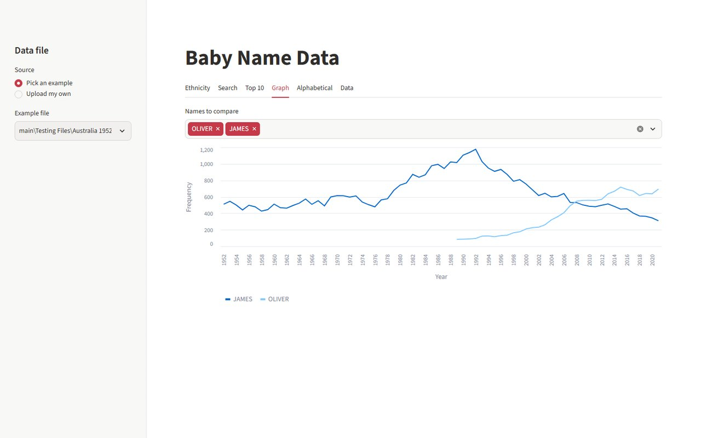
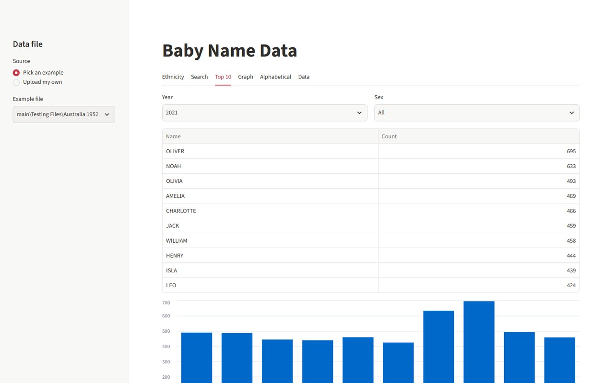

# Baby Names Frequency Tracker

A Python app for exploring baby name data from different countries and years: search names, see each year's top 10, graph names over time, and estimate the ethnic makeup of people with each name.





## Features

- **Example data or your own:** pick one of the bundled data sets (Australia, California, Newfoundland and Scotland), or upload a CSV or Excel file.
- **Flexible headers:** columns such as Gender, Position, Total or First Name are recognised and mapped automatically.
- **Six views:** Ethnicity, Search, Top 10 (by year and sex), Graph (compare names over time), Alphabetical, and Data (with a CSV download).
- **Ethnicity estimates:** uses the 2020 U.S. Census first-name table through `ethnicolr`.

## Running it

Requires Python 3.

```
pip install streamlit pandas openpyxl ethnicolr
streamlit run drive-download-20240113T005539Z-001/main/app.py
```

The app opens at http://localhost:8501.

The original menu-driven terminal version is still available:

```
cd drive-download-20240113T005539Z-001/main
python teamProjectMain.py
```

## Project layout

- `drive-download-20240113T005539Z-001/main/app.py` is the web app.
- `drive-download-20240113T005539Z-001/main/teamProjectMain.py` is the original terminal program.
- `drive-download-20240113T005539Z-001/main/Testing Files/` holds the example data sets.

## Background

Originally a team project with a terminal menu, later rebuilt with a web interface.
